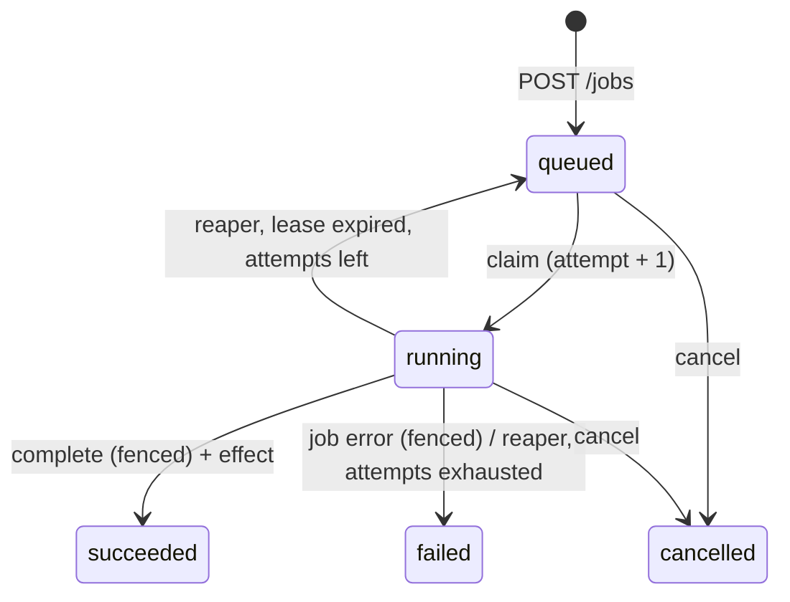

# SPEC — Training-Job Queue (Soup backend take-home)

**Stack:** Python 3.12 (Docker) · FastAPI · psycopg 3 · PostgreSQL 16 · pytest
**Guarantee:** at-least-once *execution*, exactly-once *committed effect* (§6)
**Task:** `Docs/TASK.pdf` · budget 4–6 h · must start with `docker compose up` · build order: `Docs/PLAN.md`

> The question to answer: **will it survive production?** Happy-path tests don't count as evidence.

| Requirement | Where |
|---|---|
| Create with idempotency key; get, list (paginated), cancel | §4 |
| States `queued → running → succeeded / failed / cancelled` | §3 |
| Postgres or SQLite + why | §2 |
| ≥ 4 workers; execution emulated by a countable side effect | §5 |
| Design note (claim, dead workers, cancel while running, guarantee) | `Docs/DESIGN.md` |
| Chaos harness: 10k jobs, 8 workers, `kill -9` ~every 2 s, dup POSTs, cancels, invariants, raw output of all runs, what it doesn't catch | §8 |
| Silent failures: double claim, zombie, cancel/complete race, retry duplicate, isolation level, clock skew | §9 |
| SHIP / DON'T SHIP at 100 rps + first fix | §10 |
| AI usage notes | `AI_USAGE.md` (source: `Docs/NOTES.md`) |

---

## 1. Overview

```
 client ──▶ API ──┐
                  ▼
             Postgres   ← single source of truth, single clock
                  ▲
   worker 1 … worker N   (separate OS processes; each also runs the reaper)
```

- Workers share nothing and coordinate only through Postgres.
- Every timestamp used for correctness is the DB's `now()`, never a worker clock.
- Every state change is **one conditional SQL statement** that names the expected source state and
  the caller's fencing token. A stale or illegal transition updates 0 rows instead of corrupting state.
- No client holds a transaction open across a round trip, so a frozen process never holds a lock.

## 2. Key decisions

- **Postgres, not SQLite.** Needs `FOR UPDATE SKIP LOCKED` (contention-free claim), row locks with
  re-check of `WHERE` after a lock wait (serialises cancel vs complete), and `INSERT … ON CONFLICT`
  (idempotency). SQLite has one writer and no `SKIP LOCKED`: 8 workers would serialise on the file lock.
- **No Redis/Celery.** Queue in Redis + state in Postgres = dual write with no shared transaction,
  i.e. new silent failures. 100 rps is easy for a Postgres queue.
- **Raw SQL, no ORM.** load → check in Python → save is a read-modify-write race. All SQL lives in
  `app/repo.py`, where it can be reviewed and deliberately broken (§8.4).
- **Separate reaper, not reclaim-inside-claim.** One statement run by every worker each second.
  Recovery time is bounded (lease + 1 s) even when all workers are busy, the claim query stays on its
  partial index, and every re-claim is visible as `running → queued → running`.
- **Cancel of a running job is immediate.** One `UPDATE` sets `cancelled`; the worker learns at its
  next heartbeat (≤ 1 s) or from a 0-row complete and writes nothing. No "cancel requested" state.
- **READ COMMITTED.** No decision is made from an earlier read; each transition is a single
  conditional `UPDATE` re-checked after any lock wait. Higher levels only add `40001` retries.

## 3. Data model



Terminal states are never left: no statement names them as a source state.
Job errors (`fail=true`) are not retried; retries come only from lease expiry, capped by `max_attempts`.

```sql
-- migrations/001_init.sql
CREATE TABLE jobs (
  id               uuid PRIMARY KEY DEFAULT gen_random_uuid(),
  idempotency_key  text  NOT NULL UNIQUE,
  request_hash     text  NOT NULL,                -- sha256 of the validated body (after defaults)
  payload          jsonb NOT NULL,                -- {"duration_ms": 300, "fail": false}
  status           text  NOT NULL DEFAULT 'queued'
                   CHECK (status IN ('queued','running','succeeded','failed','cancelled')),
  attempt          int   NOT NULL DEFAULT 0,      -- fencing token, +1 on every claim
  worker_id        text,                          -- diagnostics only
  lease_expires_at timestamptz,
  error            text,
  created_at       timestamptz NOT NULL DEFAULT now(),
  started_at       timestamptz,
  finished_at      timestamptz,
  CHECK ((status = 'running') = (lease_expires_at IS NOT NULL))
);
CREATE INDEX ix_jobs_queued  ON jobs (created_at, id)        WHERE status = 'queued';
CREATE INDEX ix_jobs_running ON jobs (lease_expires_at)      WHERE status = 'running';
CREATE INDEX ix_jobs_page    ON jobs (created_at DESC, id DESC);

-- The side effect. Deliberately NO UNIQUE(job_id): a fencing bug must show up as a countable
-- duplicate, not be hidden by a constraint.
CREATE TABLE job_effects (
  id         bigserial PRIMARY KEY,
  job_id     uuid NOT NULL REFERENCES jobs(id),
  attempt    int  NOT NULL,
  worker_id  text NOT NULL,
  created_at timestamptz NOT NULL DEFAULT clock_timestamp()
);

-- Audit, written by an AFTER INSERT OR UPDATE OF status trigger in the same transaction as the
-- change, so a kill can't separate them. Source for re-executions and the double-claim check.
CREATE TABLE job_transitions (
  seq         bigserial PRIMARY KEY,               -- total order
  job_id      uuid NOT NULL,
  from_status text,                                -- NULL on insert
  to_status   text NOT NULL,
  attempt     int  NOT NULL,
  at          timestamptz NOT NULL DEFAULT clock_timestamp()
);
```

## 4. HTTP API

| Method | Path | Responses |
|---|---|---|
| `POST` | `/jobs` (header `Idempotency-Key` required) | 201 new · 200 replay · 409 same key, different body · 400 |
| `GET` | `/jobs/{id}` | 200 · 404 |
| `GET` | `/jobs?limit=&cursor=&status=` | 200 `{items, next_cursor}` |
| `POST` | `/jobs/{id}/cancel` | 200 · 409 already terminal · 404 |
| `GET` | `/healthz` | 200 |

Body: `{"duration_ms": 0..60000, "fail": false}`.

**Create.** `INSERT … ON CONFLICT (idempotency_key) DO NOTHING RETURNING *`. No row → `SELECT` by key
(separate autocommit statement, so it sees the winner): same `request_hash` → 200 with the existing
job, different → 409. The unique index is the arbiter for concurrent requests; with different bodies
the first committer wins. The hash is over the validated model, so an explicit default isn't a 409.

**List.** Keyset pagination on `(created_at DESC, id DESC)`, opaque base64 cursor, `limit` 1..200
(default 50). Stable while jobs are being inserted, unlike `OFFSET`.

**Cancel.**
```sql
UPDATE jobs SET status='cancelled', finished_at=now(), lease_expires_at=NULL
 WHERE id=$1 AND status IN ('queued','running')
RETURNING *;
-- 0 rows → SELECT: cancelled → 200 (idempotent); succeeded/failed → 409; missing → 404
```

**Timeouts.** API sessions: `statement_timeout=5s`, `lock_timeout=2s` (→ 503, the client retries).
Server: `idle_in_transaction_session_timeout=2s` as a backstop. Worker sessions: `statement_timeout=3s`.

## 5. Workers

Single-threaded process, `WORKER_ID = worker-<host>-<pid>`. Compose runs 4; the chaos harness spawns 8.

| Setting | Value |
|---|---|
| Lease | 5 s |
| Heartbeat / reap interval | 1 s |
| Max attempts | 5 |
| Idle poll | 100–500 ms, jittered backoff |

**Claim**
```sql
UPDATE jobs SET status='running', attempt=attempt+1, worker_id=$w,
       lease_expires_at = now() + make_interval(secs => $lease),
       started_at = coalesce(started_at, now())
 WHERE id = (SELECT id FROM jobs WHERE status='queued'
              ORDER BY created_at, id FOR UPDATE SKIP LOCKED LIMIT 1)
RETURNING id, payload, attempt;
```
`SKIP LOCKED`: two workers never get the same row. The returned `attempt` is the worker's fencing
token for every later write. Order is approximately FIFO.

**Execute** in ~100 ms chunks for `duration_ms`. Heartbeat between chunks when due, **in the same
loop** (a heartbeat thread would keep a hung job alive forever):
```sql
UPDATE jobs SET lease_expires_at = now() + make_interval(secs => $lease)
 WHERE id=$id AND status='running' AND attempt=$a;
```
0 rows (cancelled or lease lost) or a DB error → abandon the job, write nothing. On an error the
lease simply expires and the job runs again.

**Complete** — effect and transition in **one statement**:
```sql
WITH done AS (
  UPDATE jobs SET status='succeeded', finished_at=now(), lease_expires_at=NULL
   WHERE id=$id AND status='running' AND attempt=$a
  RETURNING id, attempt)
INSERT INTO job_effects (job_id, attempt, worker_id)
SELECT id, attempt, $w FROM done;
-- 0 rows inserted → cancelled or lease lost; nothing written
```
`fail=true` → the same fenced `UPDATE` to `failed` with an error, no effect.

**Reaper** (every worker, every second):
```sql
UPDATE jobs SET
  status = CASE WHEN attempt >= $max THEN 'failed' ELSE 'queued' END,
  error  = CASE WHEN attempt >= $max THEN 'lease expired; attempts exhausted' END,
  finished_at = CASE WHEN attempt >= $max THEN now() END,
  lease_expires_at = NULL
 WHERE id IN (SELECT id FROM jobs WHERE status='running' AND lease_expires_at < now()
               FOR UPDATE SKIP LOCKED LIMIT 500);
```
A `kill -9`ed worker's connection closes and Postgres rolls back anything open; its job stays
`running` until the lease passes, then is requeued. Worst-case recovery ≈ 6 s. A slow-but-alive
worker is treated as dead, by design; fencing makes its late writes no-ops.

## 6. Delivery guarantee

**At-least-once execution, exactly-once committed effect.**
- A job can *run* more than once (killed after the work, before the commit). Re-executions are
  counted from `job_transitions` (claims per job). Exactly-once *execution* is impossible with
  crash-prone workers.
- The effect commits in the same statement as `running → succeeded`, fenced by `attempt` and
  `status`, so: **exactly one effect per succeeded job, zero otherwise**, never after a cancel.
- Runs can overlap: a reaped or cancelled worker keeps computing until its next heartbeat (≤ ~1 s).
- **Caveat:** this holds because the effect is in the same database. An external effect (S3,
  webhook, payment) degrades to at-least-once unless the receiver dedupes on `job_id`/`attempt`
  or the effect goes through an outbox.

## 7. Failure scenarios

| Scenario | Outcome | Protected by |
|---|---|---|
| Two workers claim at once | Different rows | `FOR UPDATE SKIP LOCKED` |
| `kill -9` mid-execution or mid-commit | Rolled back; requeued after lease; runs again | lease + reaper + atomic complete |
| Worker frozen past its lease, resumes (zombie) | Heartbeat/complete update 0 rows | fencing `attempt` + `status` predicate |
| Frozen worker blocks others | Impossible: holds no locks | single autocommit statements |
| Cancel vs complete | Row lock serialises; one wins | `status` predicates |
| Cancel vs reaper requeue | Cancel matches `queued` or `running` | single-statement cancel |
| Client retries `POST` | Same job, 200 | `UNIQUE(idempotency_key)` + `ON CONFLICT` |
| Same key, different body | 409 | `request_hash` |
| Worker clock skew | No effect on leases | DB `now()` only |
| Poison job crashes every worker | `failed` after 5 attempts | `max_attempts` in reaper |

## 8. Chaos harness (`chaos/harness.py`)

`docker compose stop workers && docker compose --profile chaos run --rm chaos --seed 1 [--zombie]`

### 8.1 Setup and actors (one seeded RNG)
- Preflight: abort if `pg_stat_activity` shows workers the harness didn't spawn. Truncate tables.
  Log header: seed, git commit, config, `SHOW transaction_isolation`.
- Spawn 8 worker subprocesses (`PYTHONUNBUFFERED=1`), each with its own log in `results/chaos/<run>/`.
- **Submitter:** 10,000 keys, each POSTed 1–3 times, partly concurrently and partly after a random
  delay. 95 % jobs 20–200 ms, 5 % 2–5 s (so heartbeats and mid-run cancels happen), 3 % `fail=true`,
  ~1 % of keys get one copy with a different body. Timeouts are logged as `unknown`.
- **Killer:** every 2 ± 0.5 s `SIGKILL` a random worker, respawn it. Records whether the victim held
  a job (DB lookup by `worker_id`). Runs until the queue is empty.
- **Canceller:** cancels ~10 % of keys at random times, some long jobs while running.
- **Zombie** (`--zombie`): every ~10 s `SIGSTOP` a busy worker for lease + 1–3 s, then `SIGCONT`.

Stop: after the killer stops, wait ≤ 60 s for `queued + running = 0` (timeout ⇒ I3 FAIL), then
check invariants. No final reap pass: it could hide a stuck job.

### 8.2 Invariants (`chaos/invariants.py`)
Checked against the DB **and** the client log (a DB-only check can't see a lost 201 or an
acknowledged cancel that was undone). Each prints PASS/FAIL, counts and example ids.

| ID | Invariant |
|---|---|
| I1 | No lost job: every key with a 2xx has exactly one row; each uncancelled one ended as its payload asks (`fail=false` → `succeeded`) |
| I2 | No duplicates: all 2xx for a key returned the same id; a different body got 409 |
| I3 | None stuck: no `queued`/`running` rows after the drain |
| I4 | ≤ 1 effect per job |
| I5 | `succeeded` ⇔ exactly one effect |
| I6 | The effect's `attempt` = the job's final `attempt` |
| I7 | Cancel respected: cancel answered 200 ⇒ final `cancelled`; final `cancelled` ⇒ a cancel was sent |
| I8 | Legal history: every `job_transitions` edge is in §3; claims per job are attempts 1..n, and each claim k > 1 follows a reaper requeue (no double claim) |

### 8.3 Report and runs
Per run (stdout + JSON, raw and unedited, in `results/chaos/`; every run incl. failed ones listed in
`results/chaos/INDEX.md`): seed, wall time, kills, **kills that hit a busy worker**, re-executions,
cancels by from-status, 409s, invariant results.

| Run | Count | Expected |
|---|---|---|
| A: kills + dup POSTs + cancels | 3 seeds | all PASS |
| Z: A + `--zombie` | 2 | all PASS |
| M1–M4 (§8.4) | 1 each | named invariant FAILs |

"Is 10,000 enough?" is argued from kills-on-busy-workers, re-executions and the mutation results,
not from the job count.

### 8.4 Mutations (`MUTATION=M1..M4`, one `if` per query in `repo.py`)
A harness that can't fail on a broken implementation proves nothing.

| ID | Break | Must fail |
|---|---|---|
| M1 | Claim = plain `SELECT … LIMIT 1`, then `UPDATE … WHERE id=$1` (no lock, no status check) | I8 + `test_concurrent_claims` |
| M2 | No `attempt` check in heartbeat and complete (run with `--zombie`) | I6 + `test_zombie_cannot_complete` |
| M3 | Complete without `status='running'` | I7 + `test_cancel_complete_race` |
| M4 | Create via SELECT-then-INSERT, unique index dropped | I2 + `test_idempotent_create` |

If a mutation does **not** fail, that is a finding about the harness and is reported as-is.
(Removing only `SKIP LOCKED` is not a valid mutation: `FOR UPDATE` waits and stays correct.)

### 8.5 What the harness does NOT catch (→ README)
DB crash / failover; network partitions and half-open TCP (`kill -9` closes sockets cleanly);
DB server clock skew; external side effects (§6); long-run bloat and pool exhaustion (~5 min run);
narrow timing windows random kills rarely hit (covered by §9 tests); isolation levels other than
READ COMMITTED; bugs in the harness itself (mitigated by §8.4).

## 9. Silent failures (`Docs/SILENT_FAILURES.md`, `tests/test_races.py`)

Deterministic tests drive the SQL in `repo.py` directly against real Postgres; no process tricks.

| Failure | Prevention | Evidence |
|---|---|---|
| Double claim | atomic claim, `SKIP LOCKED` | `test_concurrent_claims` (50 threads, 20 jobs → each claimed once); I8; M1 |
| Zombie worker | fencing `attempt` + `status` on every write | `test_zombie_cannot_complete`: claim (a=1), expire lease, reap, claim (a=2); heartbeat/complete with a=1 → 0 rows; one effect with a=2. Run Z; M2 |
| Cancel / complete race | row lock + `status` predicates | `test_cancel_complete_race`: tx A holds the complete `UPDATE`, cancel blocks → 409 + 1 effect; reverse order → 200 + 0 effects. I7; M3 |
| Duplicate on retry | unique index + `ON CONFLICT` + hash | `test_idempotent_create`: 50 concurrent POSTs, one key → 1×201, 49×200, one row; other body → 409. I1, I2; M4 |
| Isolation level | READ COMMITTED + single conditional statements | `test_naive_pattern_breaks_under_rc`: read-then-update without predicate double-processes; ours doesn't |
| Clock skew | leases use DB `now()` only; worker clock only schedules heartbeats (monotonic) | Argument + grep: no `time.time()`/`datetime.now()` in lease logic or SQL params. A slow worker clock = late heartbeat = zombie case, covered above |

## 10. Verdict at 100 rps (`Docs/VERDICT.md`)

Decided **from measurements**. `loadtest/load.py`: 100 rps for 5 min (60 % get, 25 % create with
~10 % retried keys, 10 % list, 5 % cancel), 4 workers, `kill -9` running. Measure p50/p99 per
endpoint, error rate, queue depth, dead tuples on `jobs`; check invariants afterwards.

**SHIP if** (written before running): all chaos runs green and every mutation caught; at 100 rps
error rate < 0.1 %, p99 < 200 ms, queue depth stable.
Format: decision → top 3 evidence → first fix → what breaks first at 10×.

## 11. Repo and compose

```
docker-compose.yml   db, api, workers ×4; profiles: test, chaos, load
Dockerfile           one python:3.12-slim image, different entrypoints
migrations/001_init.sql
app/      config.py · db.py · api.py · repo.py (all SQL) · worker.py (incl. reaper)
chaos/    harness.py · invariants.py
loadtest/ load.py
tests/    conftest.py · test_api.py · test_races.py
results/  chaos/<run>/… + INDEX.md · load/…
Docs/     SPEC · PLAN · NOTES · DESIGN · SILENT_FAILURES · VERDICT
```

`docker compose up` → DB + API + 4 workers. Tests, chaos and load are opt-in profiles; the DB gets
`idle_in_transaction_session_timeout=2s` via `command`.

## 12. Known weaknesses (candidates for "fix first")

- **Polling** grows with the fleet → `LISTEN/NOTIFY` as a wake-up hint.
- **Heartbeat churn:** an `UPDATE` per running job per second on the hot table, not HOT because
  `lease_expires_at` is indexed → autovacuum tuning, lower `fillfactor`, or a narrow leases table.
- **Single DB:** SPOF and throughput ceiling; failover not tested.
- **Cancel reports before the work stops** (≤ ~1 s).
- **Lease 5 s is a guess:** too short → needless re-runs, too long → slow recovery.
- **Half-open connections** rely on TCP keepalive defaults; not tested.
- No idempotency-key TTL, auth, rate limits, or DLQ beyond `failed`.
- Exactly-once effect is local to Postgres (§6).

## 13. Deliverables

- [ ] `docker compose up` works; README with every command and §8.5.
- [ ] `Docs/DESIGN.md` (1 page), committed before the code.
- [ ] Harness + raw output of **all** runs + `INDEX.md`.
- [ ] `Docs/SILENT_FAILURES.md` with evidence per item (§9).
- [ ] `Docs/VERDICT.md` + "what surprised me / what still concerns me".
- [ ] `AI_USAGE.md` (from `Docs/NOTES.md`).
- [ ] Reply to team@trysoup.dev with the repo link.

Cut order if time runs out: load-test kills → run Z down to 1 → `test_naive_pattern_breaks_under_rc`.
Never cut: run A, M1–M4, the §9 race tests.
